# we-grid-angular

[](https://www.npmjs.com/package/we-grid-angular)
[](https://www.npmjs.com/package/we-grid-angular)
[](https://github.com/emrecirik/we-grid/actions/workflows/ci.yml)
[](LICENSE)
[](https://angular.dev)
[](docs/theming.md)

[English](README.md)

Hiçbir tema/CSS framework bağımlılığı olmayan (Bootstrap/Material gerekmez), Angular CDK üzerine
kurulu standalone component/direktiflerden oluşan, ücretsiz ve temalanabilir bir Angular veri grid'i.

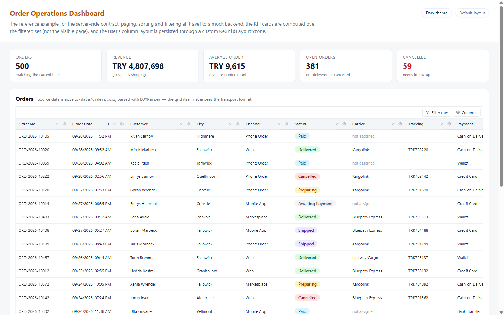

## Özellikler

- **Tarayıcıda elli milyon satır**: `WeGridColumnStore` her kolonu değerlerinin izin verdiği en küçük tipli dizide tutar (satır başına ≈ 14 bayt) ve sıralama, filtre, aramayı bu kodlar üzerinde yapar. Bir milyon satırda aynı tarayıcıda AG Grid Community'den 12× hızlı görüntüler, 90× hızlı sıralar, 45× hızlı filtreler; Web Worker'da (`WeGridWorkerStore`) elli milyon satırı sıralarken, gruplarken ya da pivotlarken bile sayfa donmaz — [ölçümler](docs/performance.md), [kendi tarayıcınızda tekrarlayın](https://emrecirik.github.io/we-grid/studio/#perf)
- **Veritabanından bir milyar satır**: `[dataSource]` olarak `WeGridProtocolDataSource` bütün bir tabloyu pencere pencere kaydırır — hayali, bir milyar satırlık bir DuckDB tablosu 0,3 sn'de açılır, 750.000.000. satıra 0,4 sn'de atlar; arama, gruplama ve pivot veritabanında çalışır ([ölçümler](docs/data-sources.md), örnek uygulama: [`big-data`](SampleUsageProjects/big-data))
- **Hesap tablosu gibi hücre seçimi** (`cellSelection`): sürükleyin, Shift+tıklayın ya da Shift+ok; sağ tıkla Kopyala, **Başlıklarla kopyala** ve **Seçimi dışa aktar** (yalnız o hücreler, CSV / Excel / PDF), alt bilgide sayı / toplam / ortalama / min / maks — AG Grid'in Enterprise'da sattığı özellikler
- **Seçimden tek sağ tıkla grafik**: sütun, çubuk, çizgi, alan, pasta, halka, dairesel çubuk, huni ya da şelale; gruplar ve tekrar eden kategoriler kendiliğinden toplanır; PNG, SVG, **gerçek ve düzenlenebilir Excel grafiğiyle Excel** olarak indirin, görsel olarak kopyalayın ya da bir çubuğa tıklayıp tabloyu filtreleyin ([doküman](docs/api.md#range-charts))
- İlişkili kolonların üzerinde **başlık bantları** (`headerGroup`) — başlıkla birlikte yapışkan, Excel'e birleştirilmiş hücre olarak gider — ve görünür kalan **sabit satırlar** (`pinnedTopRows` / `pinnedBottomRows`): hedef ya da geçen yıl toplamı
- **`<we-chart>`**: düz SVG grafikler, **klavyeyle gezinme** (tek sekme durağı, ok tuşları, değerler sesli okunur), ekran okuyucular için tek cümlelik özet ve şelale grafiği ([doküman](docs/charts.md))
- Kolon gizle/göster, yeniden adlandır, sürükle-bırak ile sıralama, yeniden boyutlandırma, sabitleme (sol/sağ), içeriğe göre otomatik genişlik
- Yoğunluk modları (rahat / normal / sıkışık)
- Kullanıcı bazlı düzen otomatik olarak kalıcı (varsayılan localStorage, backend store eklenebilir)
- Excel/DevExpress tarzı checklist başlık filtresi, **varsayılan olarak her kolonda**: tekil değerleri işaretleyin, dışarı tek bir `'in'` filtresi çıksın — değerler yüklü satırlardan ya da `checklistValuesProvider` ile tüm veri kümesinden gelir
- Filtre satırı + kolon bazlı operatör popover'ı (içerir, =, >, <, arasında, tarih aralığı), aktif filtre çipleriyle
- Verinin gerçekte sakladığı şeye uygun kolon tipleri: `number`, `integer`, `currency` — **kuruş / cent** olarak saklanan tutarlar dahil (`minorUnits: true`) — `percent`, `date`, `datetime`, `time`, `boolean` ve `email` / `url` / `phone` bağlantıları, ayrıca kolon bazında `formatter`
- Kolon bazında operatör kısıtlama (`filterOperators`): backend'in yalnızca belirli şekilde eşleştirebildiği alanlar için
- Locale'e duyarlı değerler: `weGridLocaleTr` ile `1.234,50` / `11.09.2026` biçimi, "istanbul" aramasında "İSTANBUL" eşleşmesi ve Ç/Ş/İ harflerinin Türk alfabesindeki yerine göre sıralama
- Tek seviyeli gruplama, daraltılabilir bölümler ve grup bazlı özetlerle
- Alt toplam (özet) satırı: toplam / ortalama / min / maks / sayım, kolon bazında
- `weGridRowDetail` şablonu ile satır genişletme (master-detail)
- Sunucu taraflı sayfalama, sıralama ve filtreleme — filtreler backend'inize gider ve yalnızca yüklü sayfayı değil **tüm tabloyu** arar ([nasıl](docs/server-side.md))
- Tamamen yerelleştirilebilir arayüz metni (`WE_GRID_LOCALE`) ve değiştirilebilir ikon seti (`WE_GRID_ICONS`, inline SVG — ikon fontuna bağımlılık yok)
- CSV, Excel (`.xlsx`) ve PDF olarak dışa aktarma; CSV/Excel içe aktarma — ek bir runtime bağımlılığı olmadan
- Grid üzerinden satır ekleme/güncelleme/silme; her kayıt işlemi backend yanıtını bekleyen bir `done` callback'i ile
- Salt CSS custom property (`--we-grid-*`) ile temalama, hazır açık/koyu tema

## Kurulum

```bash
npm install we-grid-angular @angular/cdk
```

Peer bağımlılıklar: `@angular/core`, `@angular/common`, `@angular/forms`, `@angular/platform-browser`,
`@angular/cdk` — Angular **18.2 ile 22** arası sürümler destekleniyor. Bu aralıktaki her major,
paketlenmiş tarball'ı o sürümde sıfırdan oluşturulmuş bir uygulamaya kurup derleyen CI işiyle doğrulanıyor.

Başlık/filtre context menülerinin kullandığı CDK overlay stilini ve isteğe bağlı hazır varsayılan
temayı uygulamanızın global stillerine ekleyin:

```json
// angular.json
"styles": [
  "node_modules/@angular/cdk/overlay-prebuilt.css",
  "node_modules/we-grid-angular/styles/we-grid-theme.scss",
  "src/styles.scss"
]
```

## Hızlı başlangıç

```ts
import { Component } from '@angular/core';
import { WeGridComponent, WeGridColumnDef } from 'we-grid-angular';

interface Product {
  id: number;
  code: string;
  name: string;
  price: number;
}

@Component({
  standalone: true,
  imports: [WeGridComponent],
  template: `
    <we-grid gridKey="products" [columns]="columns" [data]="products" trackByField="id"></we-grid>
  `
})
export class ProductListComponent {
  columns: WeGridColumnDef<Product>[] = [
    { field: 'code', header: 'Kod', width: 120 },
    { field: 'name', header: 'Ad', width: 220 },
    { field: 'price', header: 'Fiyat', type: 'currency', width: 130, summary: 'sum' }
  ];
  products: Product[] = [/* ... */];
}
```

`gridKey` zorunludur — kullanıcının kolon düzeni bu anahtarla saklanır, her grid örneği için benzersiz olmalıdır.

## Kolon tipleri ve biçimlendiriciler

```ts
columns: WeGridColumnDef<Urun>[] = [
  { field: 'stok', header: 'Stok', type: 'integer', summary: 'sum' },
  { field: 'fiyatKurus', header: 'Fiyat', type: 'currency', format: 'TRY', minorUnits: true }, // 12345 → ₺123,45
  { field: 'indirim', header: 'İndirim', type: 'percent' },                                    // 0.25 → %25
  { field: 'agirlik', header: 'Ağırlık', type: 'number', formatter: (v) => `${v} kg` },
  { field: 'acilis', header: 'Açılış', type: 'time' },
  { field: 'eposta', header: 'E-posta', type: 'email' },                                       // mailto: bağlantısı
  { field: 'web', header: 'Web', type: 'url' }
];
```

`minorUnits` kolonu ekranda ve filtre/düzenleme kutularında **lira** ile gösterilir ve yazılır;
satırlarda, sıralamada, toplamda ve **backend'e giden filtrede kuruş** kalır. Kullanıcı "Fiyat > 500"
yazdığında backend `50000` alır, yani `WHERE fiyat_kurus > @deger` doğrudan çalışır. Tüm tipler:
[column-types.md](docs/column-types.md).

## 3.000 kayıtta filtreleme — ekranda yalnızca 20'si varken

Grid, `data` içinde ne varsa onu gösterir. Backend'den sayfa sayfa yüklüyorsanız, grid'in kendi
çalıştırdığı bir filtre yalnızca o sayfayı görebilir. Tüm tabloda aramak için filtreleri backend'e
gönderin — gereken dört şey:

1. `[serverSide]="true"` + `[totalCount]`, `[page]`, `[pageSize]`, `(pageChange)`
2. `filterMode="server"` + `(filterChange)` — grid yerelde filtrelemeyi bırakır, filtreleri size verir
3. Backend önce filtreler, sonra sayar, en son sayfalar: `WHERE` → `COUNT(*)` → `ORDER BY` → `OFFSET/FETCH`
4. Checklist kolonları için `[checklistValuesProvider]` — yoksa liste yalnızca yüklü sayfanın değerlerini gösterir

```html
<we-grid gridKey="urunler" [columns]="columns" [data]="rows" [loading]="loading"
         [serverSide]="true" [totalCount]="totalCount" [page]="page" [pageSize]="20"
         (pageChange)="onPageChange($event)"
         filterMode="server" (filterChange)="onFilterChange($event)"
         [checklistValuesProvider]="checklistValues"></we-grid>
```

```ts
onFilterChange(e: WeGridFilterChangeEvent): void {
  this.filters = [...e];            // [{ field: 'ad', operator: 'contains', value: 'cıvata' }, …]
  if (e.resetPage) this.page = 1;   // filtre değişti → 1. sayfa, TEK istekte
  this.load();                      // POST /api/urunler/ara { page, pageSize, filters }
}

// checklist'ler yalnızca bu sayfanın değil, tüm tablonun değerlerini listeler
checklistValues: WeGridChecklistValuesProvider = (req) => this.http.post('/api/urunler/distinct-values', req);
```

Bileşenden SQL'e tam anlatım — istek gövdesi, tüm operatörler, EF Core ve SQL örnekleri, "yalnızca
bu sayfada aranıyor" uyarısının nedenleri — [server-side.md](docs/server-side.md) dosyasında.
[`retail-market`](SampleUsageProjects/retail-market) örneği bu kurulumun çalışan hâlidir.

## Ekran görüntüleri

Aşağıdaki görsellerin tamamı bu depodaki örnek uygulamalardan alınmış gerçek ekranlardır; hepsini
tek sayfada görmek için [ekran galerisine](https://emrecirik.github.io/we-grid/) bakabilirsiniz.

### Bir milyon satırda AG Grid Community ile kıyas, veritabanından bir milyar satır

Aynı bir milyon hayali satır, kolon ve biçim, aynı tarayıcıda; AG Grid Community 36.3 kendi
varsayılanlarıyla — üretim derlemesi, Windows 11 üzerinde Chrome. Her adımda iki süre:
**sonucun ekrana gelmesi · bu arada sayfanın kare çizemediği en uzun süre**.

| Bir milyon satır | AG Grid Community | we-grid sütun motoru | Hız farkı | Web Worker'da motor |
|---|---:|---:|---:|---:|
| İlk görüntü | 1.370 ms | 110 ms | **12×** | 140 · 24 ms |
| Tutara göre sıralama | 5.741 ms | 63 ms | **90×** | 68 · 17 ms |
| Şehir = Ankara filtresi | 2.079 ms | 46 ms | **45×** | 64 · 19 ms |
| "selin izmir" araması | 1.189 ms, 0 satır bulur | 123 ms | **10×** | 98 · 18 ms |
| Bellekteki veri | 336 MB JS heap | 14 MB | **24× az** | 14 MB, worker'da |
| Şehre göre gruplama / pivot | Yalnız Enterprise | 73 ms / 94 ms | — | — |

Süreler koşudan koşuya değişir — aşağıdaki görüntü daha sonraki bir koşudur (12× / 78× / 32× / 13×) —
bu yüzden **kendiniz ölçün**: [we-grid Studio'nun Performans sekmesi](https://emrecirik.github.io/we-grid/studio/#perf)
aynı adımları iki tablo için sizin cihazınızda çalıştırır. Yöntem, on ve elli milyon satır:
[docs/performance.md](docs/performance.md). Yalnız AG Grid Community ile kıyaslıyoruz: açıkça
çalıştırıp yayımlayabildiğimiz o; diğer tablolar ticari ve ölçülmedi.

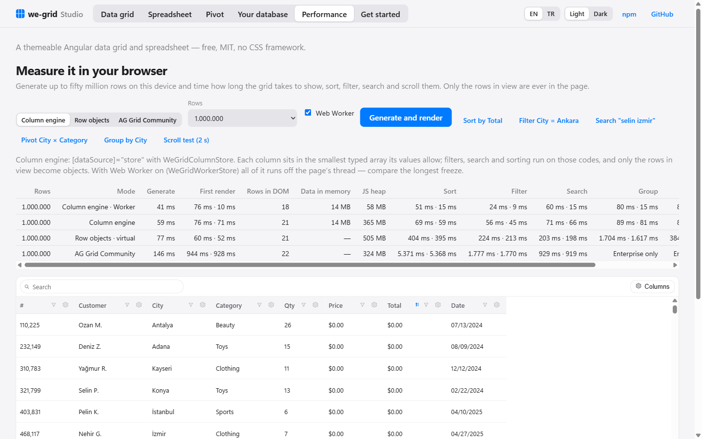

Web Worker'da on milyon üretilmiş satış, "kaan izmir" araması (71.905 satır) —
[`big-data`](SampleUsageProjects/big-data) örneği:

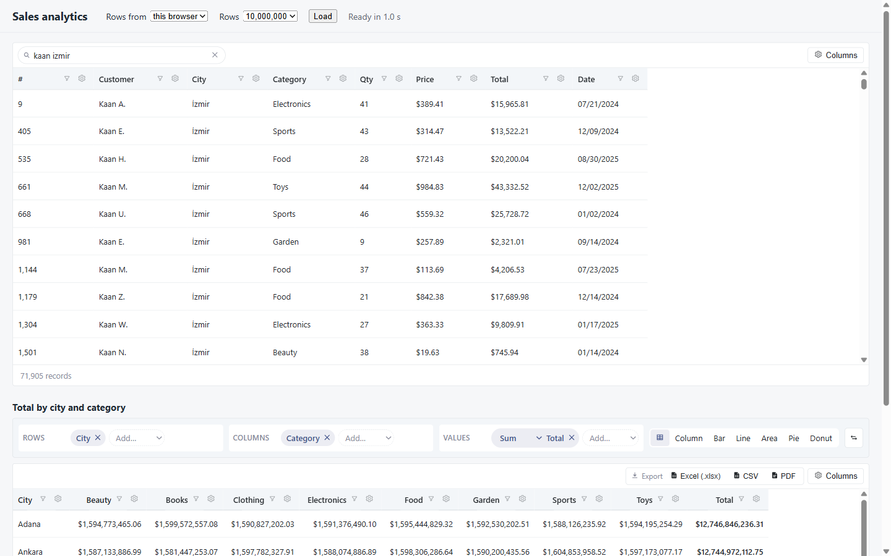

Aynı ekran, we-report Node.js backend'i üzerinden **hayali, bir milyar satırlık bir DuckDB
tablosunda**, 750.000.000. satıra kaydırılmış; pivotu veritabanı hesaplıyor
([ölçümler](docs/data-sources.md)):

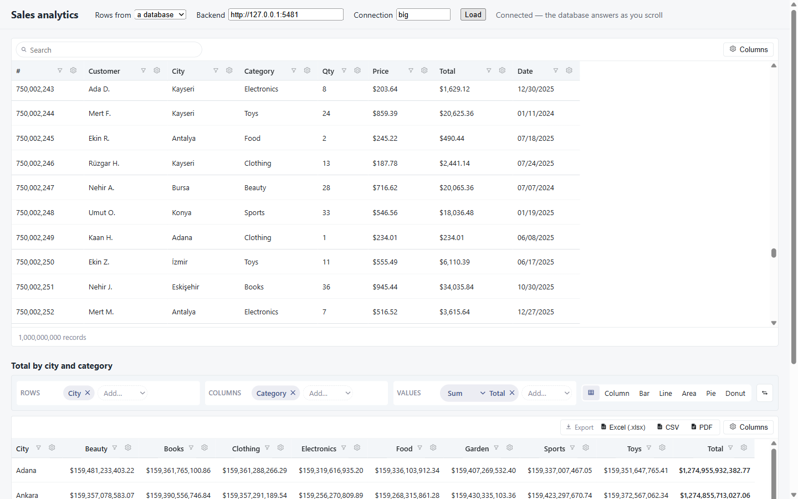

### Bir hücre bloğu seçin — kopyalayın, dışa aktarın, grafiğini çizin

Hücrelerin üzerinde sürükleyin, alt bilgi toplamı göstersin; bloğa sağ tıklayıp kopyalayın (başlıklı ya da başlıksız), yalnız o hücreleri dışa aktarın ya da grafiğini çizin. Üstteki başlık bantları (`headerGroup`) müşteri, ürün ve tutar kolonlarını gruplar. [we-grid Studio](https://emrecirik.github.io/we-grid/studio/)'da deneyin.

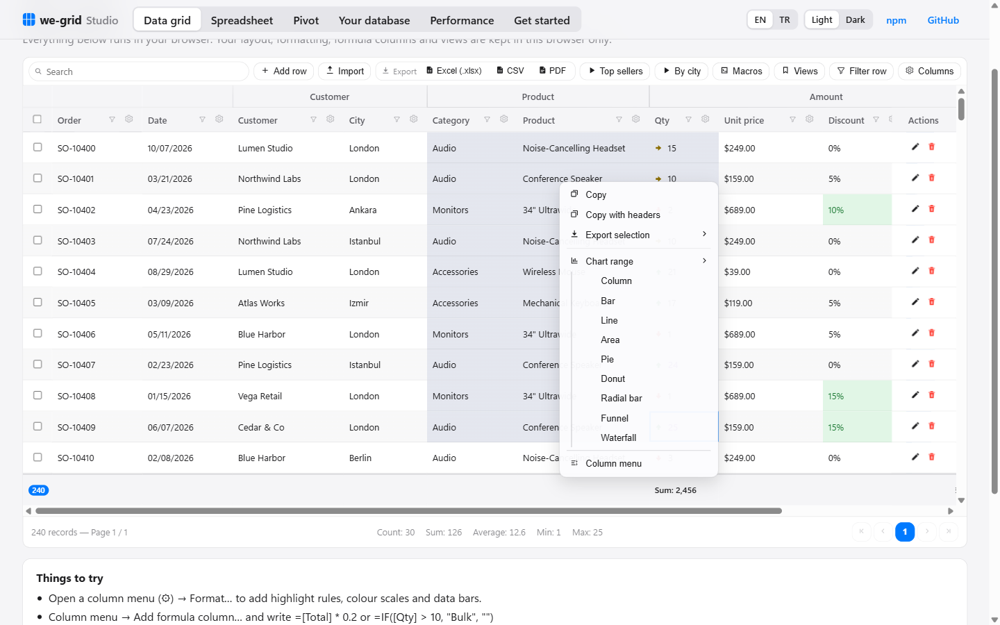

Grafik, kategori ve seriler seçilmiş olarak açılır — tekrar eden kategoriler toplanır — ve PNG, SVG ya da gerçek, düzenlenebilir Excel grafiğiyle Excel olarak iner.

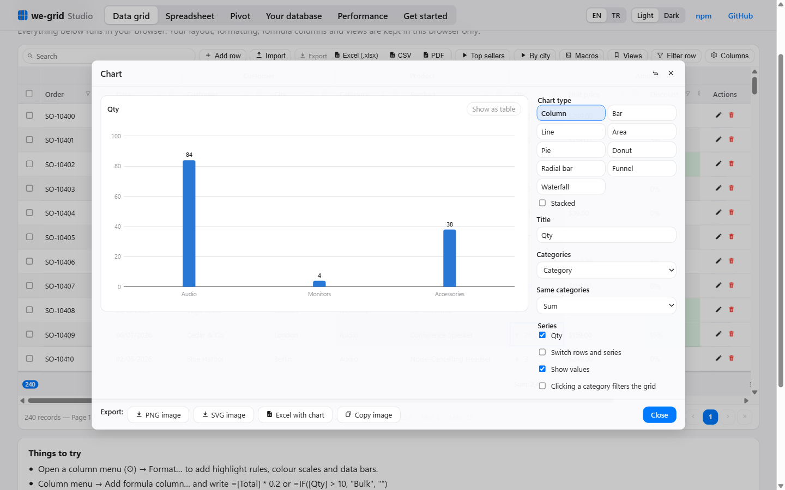

### Kolon menüsü — son kullanıcının değiştirebildiği her şey

Başlığa sağ tıklayın (veya ⚙ düğmesini kullanın): kolon gizleme, yeniden adlandırma, sabitleme,
sıralama, içeriğe göre genişletme, alt toplam fonksiyonu seçme, yoğunluk değiştirme, kolona göre
gruplama ve düzeni sıfırlama. Seçilen her şey kullanıcı ve `gridKey` bazında saklanır.

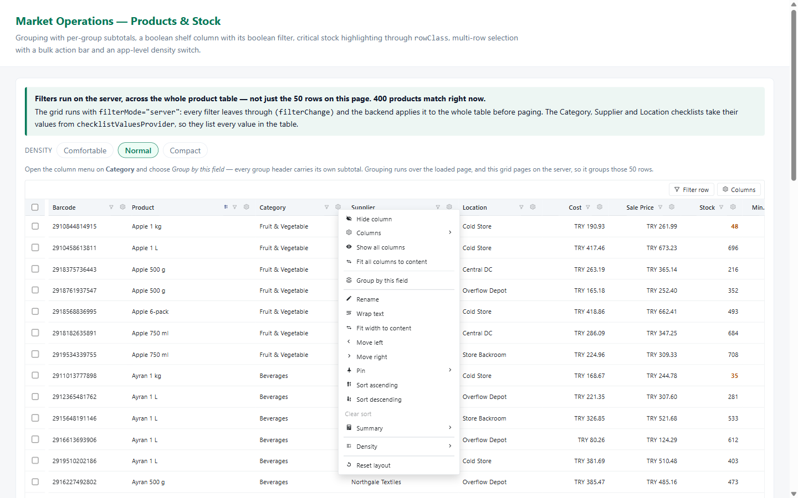

### Filtre satırı, filtre çipleri ve canlı toplamlar

Filtre satırı her kolona bir operatör ve değer verir; aktif filtreler kaldırılabilir çiplere dönüşür.
`serverSide` açıkken her değişiklik yalnızca bir event'tir — bu örnekteki KPI kartları ve alt toplam
satırı, görünen sayfayı değil filtrelenmiş kümenin tamamını temel alarak backend'de hesaplanır.

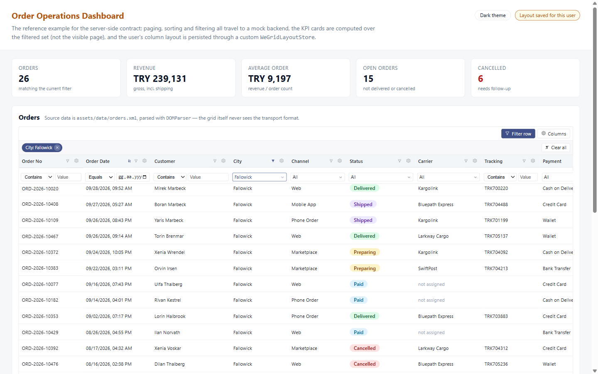

### Checklist başlık filtresi — operatör değil, değer işaretleyin

Filtrelenebilir her kolonda varsayılan olarak açıktır (grid'e `headerFilterMode="operator"` vererek
ya da kolon bazında operatör popover'ına dönebilirsiniz): huni ikonu yüklü satırların — ya da
`checklistValuesProvider` ile tüm tablonun — tekil değerlerini listeler — arama kutusu, tümünü seç kutusu ve boş değerler
için ayrı bir satırla birlikte. Seçim, ham kodları taşıyan tek bir `'in'` filtresi olarak çıkar;
backend bunu tüm tablo üzerinde tek bir `IN (…)` sorgusuna çevirir. Etiketleri `displayValue`
üretir, yani kullanıcı "Shipped" işaretlerken sorguya `40` gider.

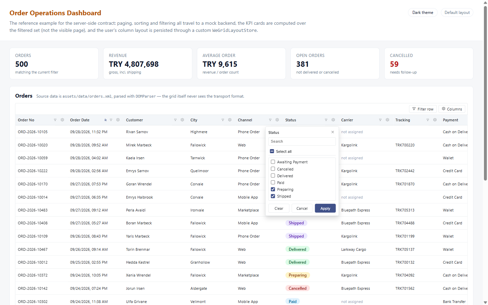

### Gruplama, grup bazlı alt toplamlar ve satır seçimi

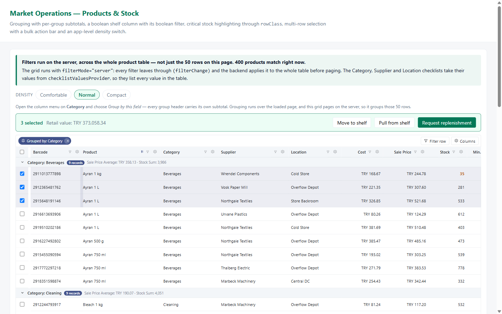

### Master-detail satırlar ve sabitlenmiş kolonlar

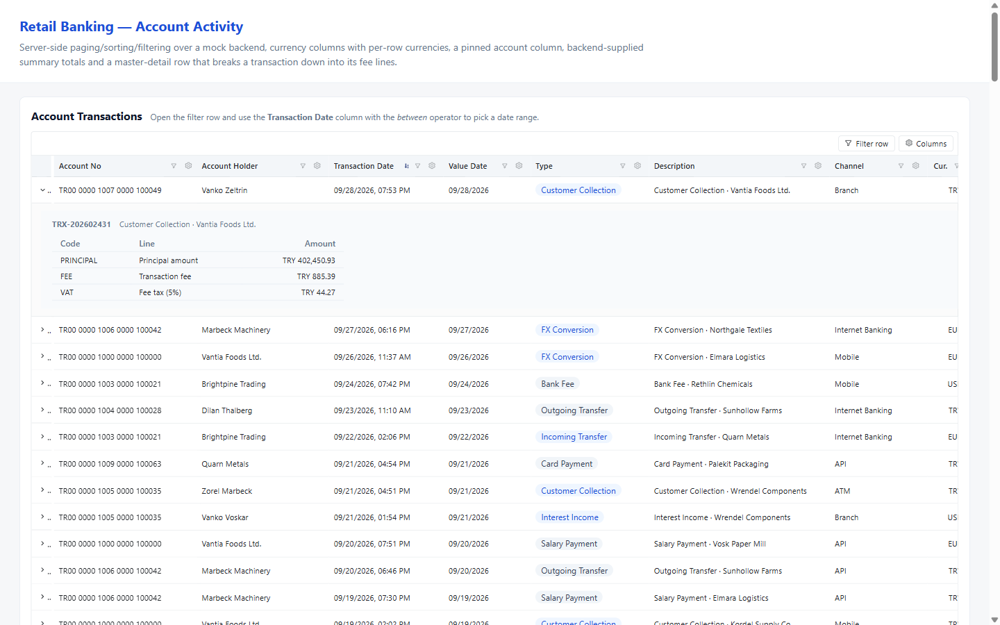

### Koyu tema

Koyu tema, üst bir elemana eklenen tek bir `data-theme="dark"` özniteliğidir — grid input'u yok,
ek bundle yok. Her renk, ezebileceğiniz bir `--we-grid-*` custom property'sidir.

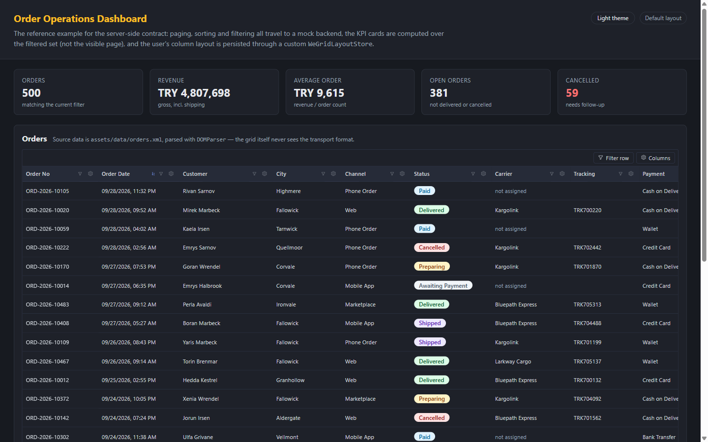

### Hesap tablosu: `<we-sheet>` ve `<we-workbook>`

Excel formülleri ve sayı biçimleri, adlandırılmış aralık (`=SUM(Planned)`), filtre düğmeleri, seçili
kolonların grafiği, seçimi toplayan durum çubuğu ve renkli sayfa sekmeleri —
[Studio](https://emrecirik.github.io/we-grid/studio/)'nun Bütçe ekranı. Hepsi gerçek bir `.xlsx`
dosyasına gider ve oradan geri gelir.

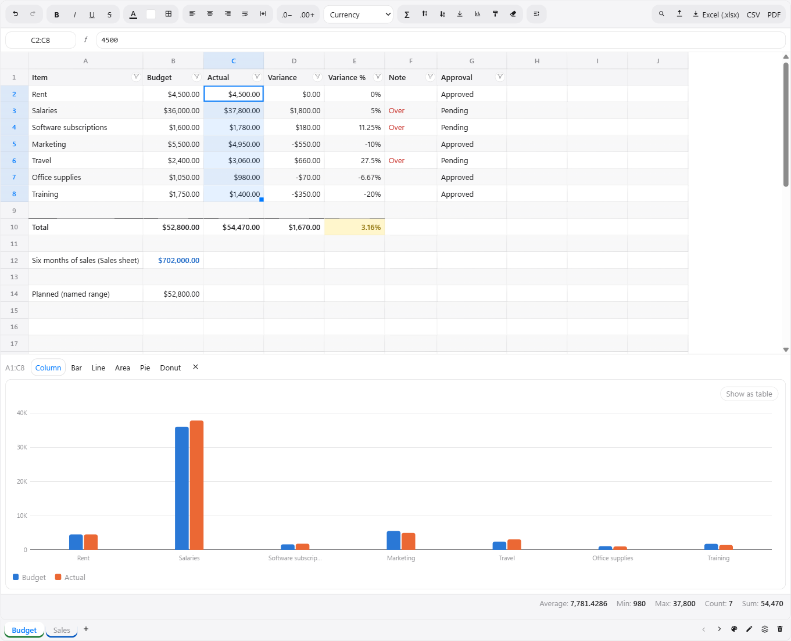

## Örnek uygulamalar

Dördü de bu workspace'te kayıtlı ve Angular CLI ile çalıştırılabilir
([`SampleUsageProjects/`](SampleUsageProjects/README.md)):

| Uygulama | Gösterdiği |
|---|---|
| [`banking`](SampleUsageProjects/banking) | Satır bazında farklı para birimleri, **kuruş** olarak saklanan kredi tutarları (`minorUnits`) ve `percent` faiz oranları, sabitlenmiş kolon, tarih aralığı filtresi, backend'den gelen toplamlar, master-detail satırlar |
| [`retail-market`](SampleUsageProjects/retail-market) | **Yüklü 50 satırda değil, tüm ürün tablosunda sunucu taraflı filtreleme**, checklist değerleri `checklistValuesProvider`'dan; alt toplamlı gruplama, `integer` kolonlar, `rowClass` ile satır vurgulama, çoklu seçim ve toplu aksiyonlar, yoğunluk değiştirme |
| [`ecommerce-dashboard`](SampleUsageProjects/ecommerce-dashboard) | Sunucu taraflı referans örnek: mock backend'e karşı sayfalama/sıralama/filtreleme, tüm veri kümesinden beslenen checklist başlık filtreleri, KPI kartları, `displayValue` ile durum rozetleri, özel layout store, XML veri kaynağı, koyu tema anahtarı |
| [`big-data`](SampleUsageProjects/big-data) | **Bir milyara kadar satır** `[dataSource]` ile: Web Worker'daki sütun motorunda 1–50 milyon satış ya da we-report backend'i üzerinden bütün bir veritabanı tablosu (hayali, bir milyar satırlık DuckDB tablosu) — arama, gruplama, checklist filtreleri ve hepsinin üzerinde bir `<we-pivot>` |

```bash
npm install
npm run build:lib                 # önce kütüphaneyi derleyin
npm run start:ecommerce           # sonra herhangi bir örnek uygulamayı
```

## Dokümantasyon

İngilizce dokümanlar birincil kaynaktır:

- [Başlarken](docs/getting-started.md)
- [Kolon tipleri ve biçimlendiriciler](docs/column-types.md) — `integer`, `percent`, kuruş/cent `currency`, `time`, bağlantılar, `formatter`
- [API referansı](docs/api.md)
- [Sunucu taraflı sayfalama/sıralama/filtreleme](docs/server-side.md) — **yüklü sayfa değil, tüm tabloda filtreleme**
- [Dışa/içe aktarma (CSV / Excel / PDF)](docs/export-import.md)
- [Satır içi düzenleme](docs/row-editing.md)
- [Temalama](docs/theming.md)
- [Yerelleştirme](docs/localization.md)
- [React ile kullanılabilir mi?](docs/react.md)

## Geliştirme

Bu depo; kütüphanenin `projects/we-grid`, özellik denemelerinin `projects/playground` ve dört örnek
uygulamanın `SampleUsageProjects/` altında olduğu bir Angular CLI workspace'idir.

```bash
npm install
npm run build:lib     # kütüphaneyi dist/we-grid altına derler
npm test              # 282 birim testi, headless Chrome
npm start             # playground uygulamasını çalıştırır
```

## Katkı

Issue ve pull request'ler memnuniyetle karşılanır — bkz. [CONTRIBUTING.md](CONTRIBUTING.md).

## Lisans

MIT — bkz. [LICENSE](LICENSE). Ticari kullanım dahil serbesttir.
